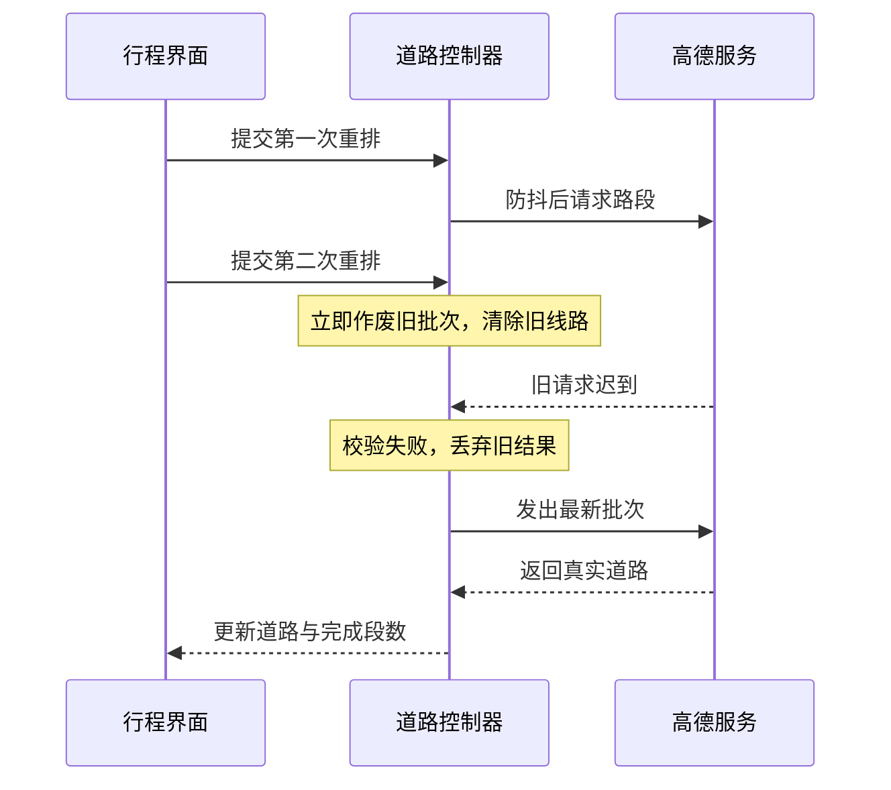

# 旅序 TripFlow：基于地图拖拽的多日旅行规划 Web 应用

Web 程序设计课程项目报告

## 摘要

自由行规划往往需要在地图、备忘录和路线查询之间反复切换。调整一个地点的日期或顺序后，原有的交通时间也需要重新核对。旅序 TripFlow 将地点搜索、地图标记和每日行程放在同一页面。用户可以把地点直接拖入某天，按实际顺序查询步行或驾车道路，并结合停留和预约查看预计时间轴。应用以 HTML、CSS 和 JavaScript 为基础，用 React 构建界面、Zustand 管理状态、dnd-kit 实现行程卡片排序，并通过高德 JS API 2.0 获取地图、地点和道路数据。旅行通过 localStorage 在当前浏览器自动保存，支持 JSON 备份、可读行程导出和历史足迹回看。项目记录显示，55 项逻辑测试、静态检查和生产构建通过。模拟浏览器测试与真实高德联调分别验证了交互边界和在线服务能力。

**关键词**　旅行规划、地图拖拽、React、异步道路查询、本地持久化

## 1. 开发背景与项目目标

规划武汉两日游时，游客可能先在地图上找到黄鹤楼、户部巷和昙华林，再到备忘录里逐个记录。如果发现第一天太赶，要把昙华林挪到第二天，就得重新核对两天的交通距离和耗时。过几天再继续规划，还可能需要在聊天记录、地图收藏和多个备忘录版本中确认哪份是最新安排。项目把这三类问题转化为具体的界面和数据设计。

| 现实痛点 | TripFlow 的解决方式 |
| --- | --- |
| 地点位置在地图里，日程顺序在备忘录里 | 地图和行程并排，地图标记可直接拖进指定日期 |
| 修改时间或顺序后，交通计划需要人工复查 | 跨天移动或重排后，按当前顺序计算受影响的相邻路段，并更新时间轴 |
| 找回、重开和分享旅行安排需要翻找多个版本 | 当前浏览器自动保存，多次旅行独立存储，可导出备份和可读行程 |

课程项目的目标是让用户在浏览器内完成从选地点到保存旅行的主要流程。单次旅行以一座城市为单位，可安排多日行程。武汉和杭州提供已核对的精选地点，其他城市可通过高德服务搜索。应用以前端和本地存储为主，在线地图、地点检索与路线计算由地图服务提供。

## 2. 需求分析

| 使用环节 | 功能与验收条件 |
| --- | --- |
| 创建旅行 | 输入名称、城市、开始日期和天数，支持调整日期结构。新增另一座城市的旅行后，旧旅行仍可在记录页独立打开。 |
| 探索地点 | 地图显示精选地点，在线结果显示名称和地址。选择准确地点后创建地图候选，支持分类、收藏和标记样式编辑。同名地点按稳定来源 ID 区分。 |
| 安排游览 | 支持拖入空白日期或卡片间的指定位置，也提供按钮。已有卡片可同日排序或跨天移动。取消拖动时保留原顺序。允许同一地点同日多次到访。 |
| 设置住宿 | 搜索酒店后可直接加入候选，并按日设为出发或入住酒店，也可设为全程酒店。行程可从出发酒店开始，经过各站后到达当晚入住酒店。 |
| 核对道路和时间 | 每日独立计算相邻路段，可按段选择步行或驾车。显示分段距离、交通用时和完成状态。时间轴结合停留与预约，缺少交通结果时标明时间下限。 |
| 保存与回看 | 刷新后恢复日期、卡片顺序及标记样式。非法 JSON 导入保留当前旅行。历史页可筛选多次旅行、手动设置状态并查看城市足迹。 |
| 适配与容错 | 桌面保留大地图和可浏览的长行程，手机可切换地图与行程。支持键盘焦点、按钮安排、撤销重做以及地图失败时的拖拽演示。 |

快速操作是本项目的重要验收场景。重复拖动、切换日期或修改交通方式期间，地图最终应显示最新顺序对应的道路。删除到没有可计算路段时，旧道路须清除。行程部分计算失败时，界面须显示成功段数及错误原因，方便用户识别目前可用的数据。

## 3. 系统概要设计

### 3.1 页面与模块

顶部导航提供「当前规划」与「旅行记录」，分别对应 `#planner` 和 `#records`。规划页左侧负责每天的行程、道路明细和时间轴，右侧负责地图、地点搜索和酒店选择。记录页通过旅行卡片进入各次规划。足迹地图展开后，桌面端以地图和旅行卡片并排显示。

| 模块 | 职责 | 主要位置 |
| --- | --- | --- |
| 页面与组件 | 日期和游览编辑、探索、地图、足迹与导出预览 | `src/App.jsx`、`src/components/` |
| 业务状态 | 旅行、日期和游览更新，编辑历史与派生计算 | `src/state/` |
| 拖放交互 | 地图拖动会话、日期落点识别、卡片排序 | `src/drag/mapDrag.js`、`src/components/Itinerary.jsx` |
| 地图服务 | SDK 装载、检索、标记同步、道路查询与市域填色 | `src/map/` |
| 本机数据 | 精选地点、旅行集合持久化与 JSON 文档校验 | `src/data/`、`src/state/document.js`、`src/state/libraryPersistence.js` |

编辑提交后，Zustand 状态向界面、道路模块和保存模块提供统一的输入。界面依据当前状态渲染卡片，地图依据有效路段结果更新，保存模块将可恢复的数据序列化。Vite 负责开发服务和生产构建。

### 3.2 数据模型

| 对象 | 关键数据 | 作用 |
| --- | --- | --- |
| Trip | 旅行 ID、名称、城市、开始日期、旅行状态 | 组织单次旅行，关联其日期和地点集合 |
| Day | 有序 `visitIds`、出发时间、出发和入住酒店、分段交通方式 | 确定当天顺序和路线输入 |
| Visit | 游览 ID、`placeId`、停留时长、预约时间和备注 | 记录一次独立到访 |
| Place | 地点 ID、名称、坐标、类别和标记样式 | 保存可复用的地点信息 |

**图 1　旅行、日期、游览与地点关系**


例如，湖滨 in77 在一次杭州旅行中只对应一个 Place，午餐和晚餐分别建立两个 Visit。两次到访可以共享地图标记，同时各自保留预约时间和备注。将晚餐移到另一天时，系统移动的是晚餐的 Visit ID，并修改相关日期的有序引用。

## 4. 关键技术与前端实现

### 4.1 HTML、JSX 与 CSS 布局

HTML 元素承担录入、展开和确认等基本交互。用户通过时间输入设置当天出发时间，在折叠区打开交通明细，在导出的原生对话框中检查打印内容。JSX 按当前状态决定表单值、按钮状态和显示内容。为了让键盘用户识别当前操作位置，界面给可聚焦控件设置明显的焦点样式。

桌面端使用 CSS Grid 排布每日行程和地图，地图栏在滚动时通过 sticky 保持可见。行程沿页面纵向展开，可以连续查看一天的多张卡片，也便于把标记拖到更靠后的落点。窄屏通过媒体查询切换到单栏，用户在「行程」与「地图」间切换，并可用「安排」按钮选择日期。米白背景、深绿主色和橙色强调贯穿导航、卡片、标记和状态提示。主要代码见 `src/styles.css`、`src/components/Itinerary.jsx` 和 `src/components/ReadableExport.jsx`。

### 4.2 React 组件与 Zustand 状态

规划页把地点探索、行程列表、道路汇总和时间轴拆成 React 组件，业务编辑集中在 Zustand store。以将昙华林移到第二天为例，提交时从第一天的 `visitIds` 移除该 ID，再把同一个 ID 插入第二天的目标位置。原 Visit 中的备注、预约和停留仍随卡片保留。日期列表、当前日期的地图编号及道路查询据此更新，时间轴随新的道路结果刷新。

路线结果、地图 SDK 实例和拖动过程中的临时状态属于运行时数据。旅行文档保存的是重新打开后可以恢复的内容。拆分后，界面能够在恢复存档时重建各项显示，在高德响应更新后再补充道路。主要代码见 `src/App.jsx`、`src/components/Itinerary.jsx` 和 `src/state/tripStore.js`。

### 4.3 地图标记拖入与卡片排序

高德 Marker 使用自定义 HTML 标签承载可识别的图标。用户按住标记拖动时，原生拖放通过 `DataTransfer` 传递地点标识。落点依据自定义数据类型和一次性拖动会话校验来源，再结合目标日期和插入位置创建 Visit。标记拖动期间暂时抑制地图平移，拖动结束后恢复相关状态。

已有卡片使用 dnd-kit 排序，拖动期间只预览插入位置，放下后提交移动。空白日期、卡片之间和列表末尾均有相应落点。取消、无效落点以及规划结构已经变化的旧拖动会话不提交。这个设计让地图拖入可以创建新的到访，同时保证跨天拖动已有卡片时保留原 Visit ID。主要代码见 `src/drag/mapDrag.js`、`src/map/placeMarker.js` 和 `src/components/Itinerary.jsx`。

### 4.4 高德搜索与异步道路联动

在线检索限定在所选城市。输入提示显示名称和地址，选择后若缺坐标则查询详情，解析失败时给出错误提示。成功解析的 POI 以稳定来源 ID 去重，并以默认五角星加入候选地图。继续输入、清空查询、选择结果或切换城市时，旧搜索回调会失效。对应实现位于 `src/map/searchController.js` 和 `src/map/searchService.js`。

道路模块按天组织端点。出发酒店可放在游览列表之前，入住酒店可附在最后。每一对相邻端点生成一段道路，选择高德 Walking 或 Driving 服务。全部日期概览按天排列和区分颜色，跨日首尾不拼接。地图绘制服务返回的路径，面板独立展示距离、交通用时和完成段数。

道路签名包含旅行文档代际、显示范围、日期、坐标顺序和交通方式等输入。改动名称、颜色、图标或备注时，业务状态会更新，但这些样式及文案不影响道路签名。真正影响线路的操作会**立即**推进请求代际、使旧结果失效并清除旧线条，随后进入约 200 毫秒的防抖窗口。每次接收结果前同时复核请求代际和当前签名，因此在等待窗口内返回的旧响应也无法更新地图。

**图 2　快速重排时的道路更新顺序**



请求在当前批次内串行执行，以方向、坐标和交通方式为键去重。真实地图适配为请求启动设置约 1.1 秒的最小间隔。道路结果不写入旅行文档。部分失败时保留成功线路和相应统计，界面明确标出完成段数，并提供重试。无步行结果、超时和 SDK 未就绪均有对应提示。同坐标的相邻到访可识别为零距离、零用时。卸载控制器时取消计时器、订阅和旧回调，并清理绘图。主要代码见 `src/state/dayRoute.js`、`src/map/routeController.js` 和 `src/map/requestLeg.js`。

### 4.5 时间轴、存档与导出

路线面板中的交通用时只统计在路上的时间。时间轴从用户设置的出发时刻推算，逐站加入交通、游览停留和预约等待。当预计早于预约抵达时，时间轴标出等待。晚于预约时可提示冲突。当上游路段缺少交通结果时，后续时间以已知部分推算并标为下限。

存档层通过 localStorage 保存旅行集合和活动旅行 ID，文档带有 `schemaVersion`。保存界面提示正在保存、已保存或失败。读到损坏存档、不支持的版本或遇到不可用存储时进入错误处理。日期、样式、游览顺序等数据可随旅行文档恢复，高德实例、DOM 和运行时请求不会被序列化。

JSON 导入先检查大小、结构、字段类型、坐标范围、唯一 ID 和关系引用，全部通过后一次提交。以同一旅行 ID 导入时更新该旅行，其他旅行保留。可读导出与备份服务于不同场景：前者可下载离线 HTML 或通过浏览器打印为 PDF，后者可重新导入并继续编辑。主要代码见 `src/state/timeline.js`、`src/state/document.js`、`src/state/libraryPersistence.js` 和 `src/state/readableExport.js`。

### 4.6 旅行记录与城市足迹

记录页以卡片显示多次旅行，提供城市、年份与状态筛选。打开一张卡片会切换活动旅行并载入其独立数据。用户手动将旅行标为「规划中」或「已去过」。足迹模块按中国市级行政编码汇总旅行，已去过显示绿色，规划中显示橙色，其他城市保持灰色。同城有多条记录时，已去过优先。

足迹地图默认收起，展开时加载行政区图层并叠加填色。点击城市可查看相关旅行，收起时释放地图与事件资源。主要代码见 `src/components/TripRecords.jsx`、`src/components/TravelFootprintMap.jsx` 和 `src/map/chinaFootprints.js`。

## 5. 功能展示与使用方法

以武汉两日游为例，可以按以下顺序体验一次完整规划。

1. 在「新增旅行」中输入「武汉两日游」，选择武汉和开始日期，设为两天。
2. 在右侧地图找到黄鹤楼、户部巷与昙华林，依次拖入第 1 天。手机版也可用「安排」按钮。观察行程顺序与地图编号是否一致。
3. 发现第一天安排偏紧时，通过卡片手柄把昙华林移到第 2 天。若要比较调整前的路线，可点「撤销」并观察道路重新计算。
4. 展开「路线与交通」，可将黄鹤楼至户部巷设为驾车，其余路段按需要设为步行。设置出发时间及停留后，在「预计时间轴」中查看抵达和离开时间。距离和耗时以实际服务返回为准。
5. 打开「导出可读行程」检查内容，可下载 HTML 或打印保存 PDF。用于迁移或继续编辑时则导出 JSON。
6. 进入「旅行记录」，保留武汉为「规划中」，将已有杭州旅行设为「已去过」。打开足迹地图查看两座城市的颜色。重开武汉并刷新，检查日期、卡片顺序和交通方式是否恢复。

如在线地图现场加载失败，可切换到页面明确标识的「拖拽演示」，继续展示拖入、排序、跨天与本地保存。在线道路和中国市域填色的能力对应既有真实联调记录。

## 6. 测试与验证

项目记录显示，2026 年 11 月 14 日在 macOS 环境复跑静态检查、55 项逻辑测试和生产构建，三项均通过。下列浏览器验证依据开发阶段验收记录，其中五项体验改进的最终验收日期为 2026 年 11 月 11 日。

| 场景 | 操作和预期 | 已记录结果 |
| --- | --- | --- |
| 拖放与日期调整 | 从地图拖入空天、插入指定位置，拖动现有卡片跨天或取消 | 模拟 SDK 的 Chrome 验收通过，取消后保留原顺序 |
| 防抖与结果竞态 | 快速重排、切换日期或方式，模拟旧结果迟到、部分失败或删除端点 | 逻辑及模拟浏览器验收通过，旧结果未覆盖当前状态，失败后可重试 |
| 多旅行存档与备份 | 新建杭州后回到武汉，刷新并尝试导入损坏文档 | 旅行保持独立，刷新恢复，非法文件保留当前数据 |
| 真实高德道路和足迹 | 武汉同日选步行与驾车，杭州检索酒店并安排往返，检查中国市域填色 | 既有在线浏览器验收通过 |
| 布局与导出 | 检查桌面至 390 像素宽度，下载离线 HTML 并生成 A4 PDF | 检查了窄屏切换与横向溢出，实际生成 PDF 并检查中文表格 |

逻辑测试及模拟 SDK 用于控制请求次序和故障条件。真实联调用于验证高德确实返回地点、道路与行政区数据。特定跨江场景恰好无步行路线，以及账号当时可用的 QPS 和每日配额，均无真实专项实测记录。[进度记录](PROGRESS.md) · [开发日志](DEVELOPMENT_LOG.md)

## 7. 总结、局限与展望

TripFlow 把地图上的地点、行程中的一次到访、道路请求和本机存档串联成完整的自由行规划流程。项目的主要实现包括地图到日期的拖放规则、跨日游览状态、按天按段的道路调度、时间轴和数据恢复。通过同一个地点对应不同 Visit，应用也能表达一天内多次到访同一地点的安排。

当前每份旅行以一个城市为单位，交通方式覆盖步行和驾车，在线能力依赖高德服务及本地网络。浏览器存储依赖当前访问源，清除站点数据会清除对应存档。跨设备迁移可借助 JSON 备份。

后续优先考虑同一旅行串联多个城市。数据模型可增加每天的所属城市，按城市组织候选地点，并用独立的跨城交通记录表示出发、到达和换乘。旅行足迹也可据此记录实际到访的多个城市。

## 参考资料与复用说明

| 来源 | 本项目的用法与实现范围 |
| --- | --- |
| TREK | 参考地图标记拖入日程和旅行足迹的交互思路。拖动会话、日期落点与市域填色由本项目实现。 |
| mirrorxyjiang/travel-planner | 按 MIT 许可修改复用 `fetchLeg` 中的道路服务调用与路径解析片段。改造后的 `requestLeg.js` 增加校验、取消、超时和清理。本项目实现状态联动、路线调度及绘图控制。 |
| zh-lon/travel-planner | 参考日期容器和拖动预览思路。本项目使用 dnd-kit 公开 API 实现落点判定和排序提交。 |
| React、Vite、Zustand、dnd-kit 和高德 JS API | 通过依赖或公开服务接口接入。页面结构、旅行数据模型、编辑规则、存档校验和测试由本项目实现。 |

- 官方地图与行政区资料。[高德 JS API 2.0 手册](https://a.amap.com/jsapi/static/doc/index.html) · [高德行政区图层](https://lbs.amap.com/api/javascript-api-v2/guide/layers/districtlayer)
- 交互参考。[TREK 仓库](https://github.com/liketrek/TREK) · [TREK 演示](https://demo.liketrek.com/dashboard) · [多日拖放组件](https://github.com/zh-lon/travel-planner/blob/ff7bac6dabe87df30f80fc00fa33aa9f6aa21508/src/components/ItineraryBoard.tsx)
- 路段适配来源与许可。[原始路线文件](https://github.com/mirrorxyjiang/travel-planner/blob/0a5df73de8cd393761c6fc1119d65317dadad731/src/map.js) · [随项目保留的 MIT 许可](../licenses/mirrorxyjiang-MIT.txt)
- 逐条地点、来源提交与采用范围。[来源与复用记录](REFERENCES.md)

## 附录　启动与复查

项目要求 Node.js 22.12 及以上的 22.x 版本或 Node.js 24 及以上，以及 npm 10 及以上。在项目根目录运行：

```sh
npm ci
npm run dev
```

另开终端执行检查与构建：

```sh
npm run lint
npm test
npm run build
```

开发入口为 http://127.0.0.1:5173/#planner。真实地图配置放在项目根目录的 `.env.local`，变量名为 `VITE_AMAP_KEY` 和 `VITE_AMAP_SECURITY_JS_CODE`。具体配置办法和生产预览命令见 [README](../README.md)。
